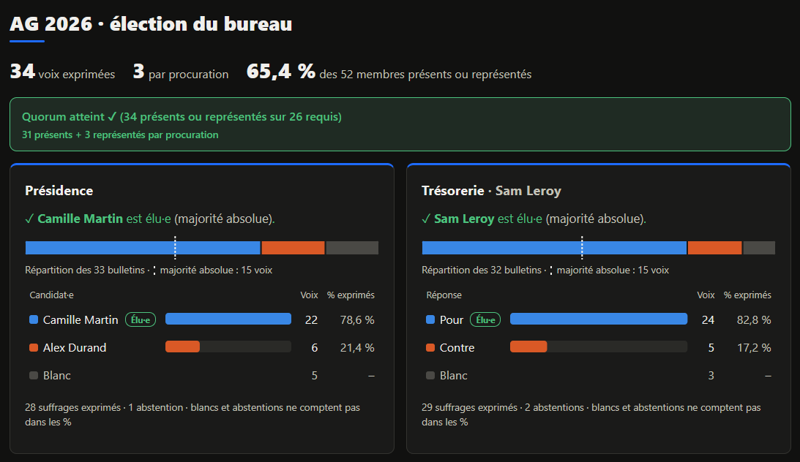

# Isoloir

[](https://github.com/jarash/isoloir/actions/workflows/ci.yml)
[](LICENSE)

Le vote à bulletin secret de l'assemblée générale d'une association, quand l'AG se tient sur Discord : l'élection du bureau, avec procurations, quorum et procès-verbal.



## Ce qu'il fait

- **Connexion avec Discord**, réservable aux membres du serveur de l'association et à un rôle (ex. « Adhérent à jour »). Pas de compte à créer, pas de mot de passe.
- **Un bulletin par poste** : un candidat, vote blanc ou abstention ; pour une candidature unique, Pour / Contre / Blanc. Majorité relative des suffrages exprimés, majorité absolue signalée.
- **Bulletin secret** : l'émargement (qui a voté) et l'urne (les choix) n'ont aucun lien (voir [ce que garantit l'anonymat](#ce-que-garantit-lanonymat)).
- **Procurations** : « X donne procuration à Y ». Y reçoit un bulletin par voix, X ne peut plus voter lui-même. Plafond par mandataire, pas de cascade.
- **Quorum** : membres inscrits et seuil saisis en amont, présents comptés pendant l'AG ; l'appli y ajoute les procurations et dit s'il est atteint.
- **Résultats visuels** à partager en écran pendant l'AG, publiables aux membres, et un résumé prêt à coller dans un salon Discord.
- **Procès-verbal** : un fichier texte avec les résultats, le quorum et la liste des votants.
- **Fin d'AG** : un bouton efface toutes les données. Une page « Confidentialité et mentions légales » informe les membres (RGPD).
- **Aux couleurs de l'association** : nom, logo, bandeau et couleurs, sans toucher au code.

Node 24 (SQLite intégré), Express, rendu côté serveur, une seule dépendance, pas de build. L'interface est en français.

## Le déroulé d'une AG

1. **Avant** (état *En préparation*) : dans **Administration**, nommer le scrutin, écrire une description (déroulé, quorum…), créer les postes et leurs candidats, saisir les procurations reçues, renseigner le quorum (membres inscrits et seuil).
2. **En début d'AG** : taper le nombre de **présents** comptés dans le salon vocal ; l'appli dit si le quorum est atteint. Les procurations peuvent encore être ajoutées pour les retardataires.
3. **Ouvrir le vote** : postes et candidats sont figés. Les membres se connectent et votent ; la participation s'affiche en direct, l'émargement donne la liste de qui a voté (jamais pour qui).
4. **Clore le vote** : les résultats apparaissent pour les admins. Partager son écran sur Discord pour les annoncer, puis, si on veut, **Publier aux membres** et copier le résumé dans un salon.
5. **Nouveau tour** (égalité à départager, second tour) : efface votes et émargement ; postes, candidats et procurations restent, et redeviennent modifiables.
6. **Après l'AG** : *Télécharger les résultats* pour le PV. Une fois le délai de contestation passé (souvent deux mois), *Effacer toutes les données* (taper `EFFACER`), et supprimer les sauvegardes du serveur.

Un vote est définitif : pas de modification une fois le bulletin déposé.

## Ce que garantit l'anonymat

- **Aucun lien dans la base.** L'urne n'a que trois colonnes : une clé aléatoire, le poste, le choix. Ni membre, ni date, ni numéro d'ordre : les lignes sont rangées par leur clé aléatoire, l'ordre d'arrivée est perdu.
- **Un bulletin est éclaté.** Les choix d'un même votant sont des lignes indépendantes : on ne peut pas reconstituer son bulletin complet. Une abstention n'écrit rien.
- **Rien dans les journaux.** Ils notent l'heure, la page et le statut de chaque requête, jamais le contenu d'un formulaire.
- **Vérifiable.** Le schéma et le vote tiennent dans [`db.js`](db.js) ; les tests vérifient que l'urne n'a pas de colonne en trop. Le pied de page de chaque site affiche le commit qu'il exécute, pour comparer avec le code publié (« modifiée » s'il diffère).

Les limites, propres à tout vote en ligne de ce type :

- **Il faut faire confiance à l'hébergeur.** Quelqu'un qui administre le serveur pourrait, en modifiant le code ou en observant la base pendant le vote, rapprocher votes et votants. Confiez l'hébergement à une personne de confiance, n'y touchez pas pendant le scrutin, et désignez des scrutateurs.
- **Les petits effectifs trahissent.** Avec deux ou trois voix sur un poste, les résultats eux-mêmes peuvent révéler des votes.
- **Pas de vérification individuelle.** Un votant ne peut pas vérifier après coup que son bulletin a été compté : c'est le prix de l'anonymat sans cryptographie.

## Mettre en ligne

Il faut un serveur avec Docker, un nom de domaine et un reverse proxy (Caddy dans le guide). Tout est dans [docs/deploiement.md](docs/deploiement.md) : application Discord, `.env.local`, Caddy, `make prod-up`, sauvegardes, mises à jour, et ce qu'il faut faire avant et après l'AG.

### Aux couleurs de l'association

- `ORG_NAME` et `ORG_URL` dans `.env.local` : le nom et le site de l'association, dans l'en-tête et le pied de page.
- Le dossier `custom/` (modèle : [`custom.example/`](custom.example/theme.css)) : `logo.svg` ou `logo.png`, `banner.jpg` pour l'accueil, et `theme.css` pour les couleurs de l'en-tête, des boutons et des accents. Il reste hors du dépôt et se change sans reconstruire.

## Développer

```bash
make up      # http://localhost:8890, avec une connexion d'essai sans Discord
make logs
make test    # ou, hors Docker : npm test
make down
```

La connexion d'essai (`DEV_LOGIN=1`, refusée en production) demande un pseudo ; cocher « Administrateur·rice » pour gérer le scrutin. Plusieurs fenêtres privées permettent de jouer plusieurs membres. La base de dev est `var/isoloir.db` : la supprimer pour repartir de zéro. Pour la vraie connexion Discord en local : `DEV_LOGIN=0 make up`, avec les `DISCORD_*` dans `.env.local`.

## Limites connues

- Un seul scrutin à la fois par installation (plusieurs postes, plusieurs tours).
- Connexion par Discord uniquement.
- Interface en français.

## Sécurité

Une faille, en particulier tout moyen de relier un bulletin à un votant ? Merci de la signaler en privé : voir [SECURITY.md](SECURITY.md).

## Licence

[AGPL-3.0](LICENSE) : vous pouvez utiliser, modifier et redistribuer Isoloir ; si vous faites tourner une version modifiée pour d'autres personnes, vous devez leur en donner le code. Pour un outil de vote, c'est la garantie que les votants peuvent toujours lire ce qui compte leurs voix.
